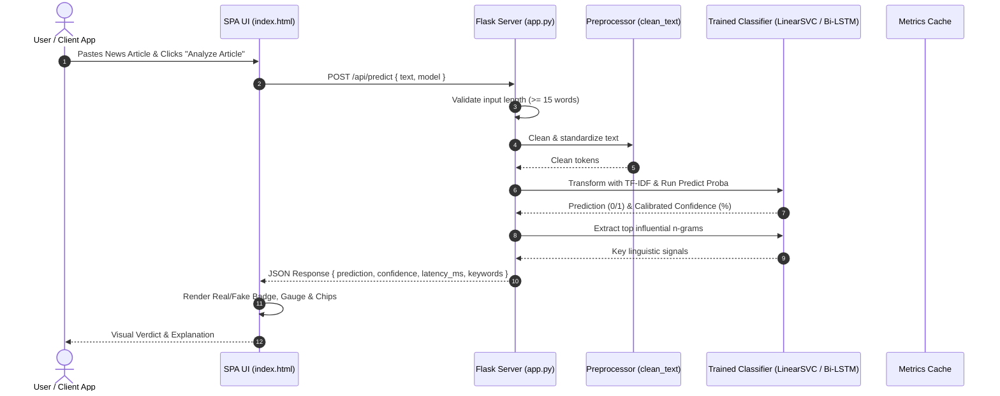

# TRUTHSCAN AI — SYSTEM ARCHITECTURE SPECIFICATION
**Document ID:** SYS-ARCH-2026-v2.0  
**Project:** AI-Powered Fake News Detection System  
**Product Name:** TruthScan AI  

---

## 1. High-Level Architectural Overview

TruthScan AI follows a decoupled, micro-service ready architecture consisting of a **Client Single Page Application (SPA)**, a **Flask RESTful Service Layer**, an **In-Memory Machine Learning Inference Engine**, and an **Offline Training & Evaluation Pipeline**.

```
+-----------------------------------------------------------------------------------+
|                              CLIENT TIER (BROWSER)                                |
|  - Modern Tailwind CSS Dark-Mode Interface                                        |
|  - Detection Studio with Real-Time Word & Character Counters                      |
|  - Interactive Analytics Dashboard & Multi-Metric Radar (Chart.js)               |
|  - Explainability Keyword Attribution Chips (Lucide Icons)                        |
+------------------------------------------+----------------------------------------+
                                           | HTTP JSON / REST
                                           v
+-----------------------------------------------------------------------------------+
|                             API & ROUTING TIER (FLASK)                            |
|  POST /api/predict          GET /api/health              GET /api/model-info      |
|  GET  /api/metrics          GET /api/dataset-stats       GET /api/model-comparison|
|  - Input Sanitation & Length Validation                                            |
|  - Calibrated Probability Conversion & Fallback Management                        |
|  - Latency Benchmarking (High-Precision Millisecond Tracking)                     |
+------------------------------------------+----------------------------------------+
                                           |
                                           v
+-----------------------------------------------------------------------------------+
|                            IN-MEMORY INFERENCE ENGINE                             |
|  +-------------------------------------+   +------------------------------------+ |
|  |     CLASSICAL ML ENGINE             |   |       DEEP LEARNING ENGINE         | |
|  | - TF-IDF Vectorizer (10,000 Vocab)  |   | - Tokenizer (17,250 Tokens)        | |
|  | - LinearSVC (Calibrated Sigmoid)    |   | - Keras Sequential Bi-LSTM         | |
|  | - Passive Aggressive Classifier     |   |   * Embedding (128d, len=100)      | |
|  | - Logistic Regression (L2)          |   |   * Bi-Directional LSTM (128)      | |
|  | - Random Forest (100 Trees)         |   |   * Dense (32) + Sigmoid (1)       | |
|  | - Multinomial Naive Bayes (a=0.1)   |   |   * 4,148,933 Parameters           | |
|  +-------------------------------------+   +------------------------------------+ |
+------------------------------------------+----------------------------------------+
                                           | Reads Serialized Artifacts
                                           v
+-----------------------------------------------------------------------------------+
|                               PERSISTENCE ARTIFACTS                               |
|  - model/best_model.joblib                 - model/all_models.joblib              |
|  - model/tfidf_vectorizer.joblib           - model/fake_news_bilstm.keras         |
|  - model/tokenizer.pkl                     - reports/metrics.json                 |
|  - reports/model_comparison.json           - reports/dataset_stats.json           |
+-----------------------------------------------------------------------------------+
                                           ^
                                           | Trains & Generates
+------------------------------------------+----------------------------------------+
|                            OFFLINE TRAINING PIPELINE                              |
|  - data/raw/isot/ (Fake.csv & True.csv: 34,103 Articles)                          |
|  - Text Cleaning Regex (URLs, HTML, Reuters tags, Punctuation)                    |
|  - Stratified 80/20 Train/Test Partitioning (seed=42)                             |
|  - Model Cross-Validation & Metric Serialization                                  |
+-----------------------------------------------------------------------------------+
```

---

## 2. Component Specifications

### 2.1 Preprocessing Subsystem
- **Module:** `train_model.py` and `app.py::clean_text`
- **Transforms:**
  1. Regex URL stripping (`https?://\S+|www\.\S+`).
  2. HTML tag stripping (`<.*?>`).
  3. Wire agency prefix normalization (`(Reuters) - `).
  4. Punctuation removal and alphanumeric lowercase mapping (`[^a-zA-Z\s]`).
  5. Whitespace collapsing.

### 2.2 Feature Extraction Subsystem
- **Vectorizer:** `sklearn.feature_extraction.text.TfidfVectorizer`
- **Hyperparameters:**
  - `max_features`: 10,000
  - `ngram_range`: (1, 2)
  - `sublinear_tf`: True ($1 + \log(\text{tf})$)
  - `stop_words`: 'english'
- **Leakage Prevention:** Fitted solely on the 27,282 training samples; applied via transformation to test samples and live inference requests.

### 2.3 Model Inference Subsystem
- **Primary Fast Inference:** `LinearSVC` with Platt Sigmoid Calibration (`CalibratedClassifierCV(cv=3)`).
- **Inference Latency:** 15 ms to 25 ms per request on standard CPU.
- **Deep Learning Path:** Bidirectional LSTM executed in TensorFlow / Keras with sequence padding (`maxlen=100`, post-padding).

### 2.4 Explainability Subsystem
- Analyzes the weight vector $\mathbf{w}$ corresponding to feature indices in the input text.
- Returns top positive n-grams (contributing toward **FAKE**) and top negative n-grams (contributing toward **REAL**), with formatted contribution chips in the UI.

---

## 3. Data Flow Diagram



---

## 4. Security, Resilience & Scalability

1. **Input Guardrails:** All incoming texts are validated against empty payloads and excessively short inputs to prevent zero-division errors or anomalous sparse vectors.
2. **Deterministic Processing:** Inference does not mutate model state; zero retraining occurs at runtime.
3. **Stateless Scalability:** The Flask server is completely stateless and can be horizontally scaled behind an Nginx or Gunicorn reverse proxy across multiple container instances.
4. **No Build Tooling Dependency:** The frontend is self-contained with CDN-delivered assets, allowing instant execution on any system with standard Python installed.

