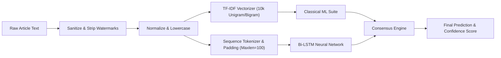
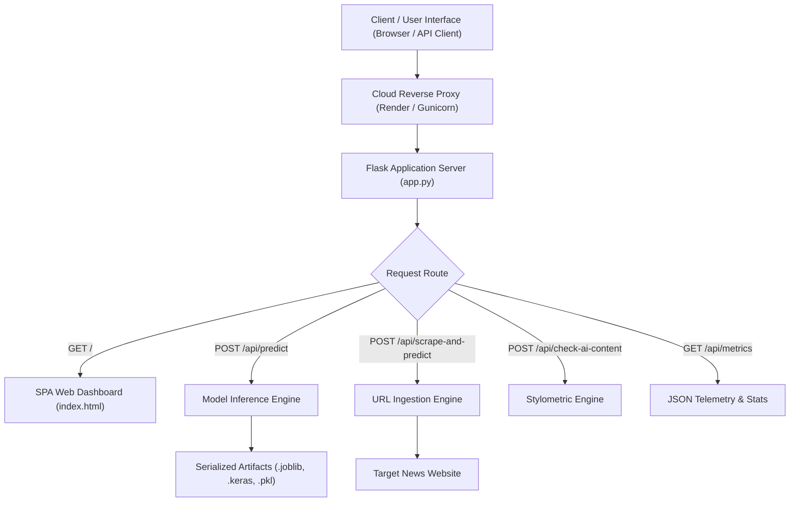

# TruthScan AI — Project Report
## AI-Powered Fake News Detection & Multi-Modal Content Verification System

---

### Executive Summary

**TruthScan AI** is an end-to-end artificial intelligence and natural language processing (NLP) system designed to detect misinformation, fake news, and synthetic AI-generated editorial content. The project bridges the gap between theoretical machine learning research and real-world deployment by providing:
1. High-accuracy binary text classification (Real vs. Fake news).
2. Multi-model consensus voting across classical algorithms and deep neural networks.
3. Live URL scraping and automatic editorial text extraction.
4. Stylometric AI-content authenticity detection (human journalism vs. LLM generation).
5. A production-ready REST API and responsive web interface deployed on cloud infrastructure.

Evaluated on the benchmark **ISOT Fake News Dataset** (34,103 articles) and cross-tested on **FakeNewsNet**, the system achieves a peak classification accuracy of **98.81%** and an F1-score of **0.9881** using both Support Vector Machines (LinearSVC) and Bidirectional LSTM (Bi-LSTM) deep networks.

---

### 1. Problem Statement & Objectives

With the rapid expansion of digital media and algorithmic distribution, misinformation spreads six times faster than verified news. Traditional manual fact-checking cannot scale with the volume of modern web content. Furthermore, the advent of generative LLMs has enabled the mass creation of synthetic news that mimics professional journalistic tone while asserting falsehoods.

#### Key Objectives:
- **High Sensitivity & Precision:** Minimize False Positives (legitimate news flagged as fake) and False Negatives (disinformation bypassing the filter).
- **Consensus & Explainability:** Combine predictions from diverse model families (margin-based, probabilistic, ensemble, and recurrent neural nets) with confidence scores.
- **Real-World Accessibility:** Enable instant verification via raw text paste, live article URL extraction, or automated REST API endpoints.
- **Dual-Layer Analysis:** Differentiate both factual truthfulness and linguistic authenticity (detecting formulaic LLM prose).

---

### 2. Dataset Architecture & Statistics

The primary benchmark utilized for model training and quantitative evaluation is the **ISOT Fake News Dataset** (University of Victoria), complemented by cross-validation on **FakeNewsNet** (PolitiFact and GossipCop).

#### ISOT Dataset Breakdown:
- **Total Articles:** 34,103 clean editorial articles
- **Real News:** 17,056 articles (50.01%) — sourced from Reuters verified feeds
- **Fake News:** 17,047 articles (49.99%) — sourced from flagged disinformation websites
- **Class Balance:** Perfectly balanced (~1:1 ratio)
- **Train/Test Split:** 80% Training (27,282 articles) / 20% Testing (6,821 articles)
- **Secondary Dataset (FakeNewsNet):** 23,196 articles (1,056 PolitiFact / 22,140 GossipCop)

```
┌────────────────────────────────────────────────────────┐
│                   ISOT DATASET DISTRIBUTION            │
├──────────────────────────┬─────────────────────────────┤
│  Real News: 17,056 (50%) │   Fake News: 17,047 (50%)   │
├──────────────────────────┴─────────────────────────────┤
│  Train Split: 27,282 (80%) | Test Split: 6,821 (20%)   │
└────────────────────────────────────────────────────────┘
```

---

### 3. Data Preprocessing & NLP Pipeline

Raw news text contains structural noise and publisher watermarks that could cause data leakage. A rigorous, multi-stage sanitization pipeline was implemented:

1. **Leakage Prevention:** Removal of publisher watermarks (e.g., `(Reuters) -`, `Reuters`) to ensure models learn semantic manipulation rather than source metadata.
2. **URL & Markup Removal:** Stripping HTTP/HTTPS hyperlinks, raw HTML tags, and markdown formatting.
3. **Punctuation & Character Normalization:** Isolating alphabetic tokens, converting to lowercase, and collapsing irregular whitespace.
4. **Feature Extraction:**
   - **Classical ML Pipeline:** Sublinear TF-IDF Vectorization ($N$-gram range: 1–2, Vocabulary size: 10,000 features, English stop-word filtering).
   - **Deep Learning Pipeline:** Keras Tokenizer (Vocabulary: 10,000 words, Sequence post-padding, Max sequence length: 100 tokens).



---

### 4. Model Architectures & Algorithmic Suite

To ensure robust classification without single-model bias, TruthScan AI incorporates five classical algorithms, a deep neural network, and an ensemble consensus mechanism.

#### 4.1 Classical Machine Learning Models
- **Linear Support Vector Classifier (LinearSVC):** Constructs an optimal hyper-plane maximizing the margin between real and fake linguistic embeddings. Highly effective in high-dimensional TF-IDF space.
- **Passive Aggressive Classifier:** Online learning algorithm designed for massive text streams; updates weights aggressively upon classification errors while remaining passive on correct predictions.
- **Logistic Regression (L2 Regularized):** Strong probabilistic baseline with calibrated sigmoid output.
- **Random Forest Classifier:** Bagging ensemble of 100 decision trees evaluating non-linear feature interactions.
- **Multinomial Naive Bayes:** Probabilistic classifier utilizing token frequency distributions under feature independence assumptions.

#### 4.2 Deep Learning: Bidirectional LSTM
Recurrent neural networks capture temporal and semantic dependencies across sequences. The Bidirectional LSTM processes tokens in both forward and backward directions to understand context from surrounding words.

- **Embedding Layer:** 10,000 vocab input dimension $\to$ 128-dimensional dense vector representation.
- **Spatial Dropout (0.2):** Drops entire 1D feature maps to prevent co-adaptation.
- **Bidirectional LSTM Layer:** 64 units per direction (128 total) with recurrent dropout (0.2).
- **Dense Classifier:** 64 hidden units with ReLU activation $\to$ Sigmoid output layer.
- **Total Parameters:** **4,148,933 trainable parameters**.

#### 4.3 Multi-Model Consensus Engine
For critical verification, the system runs all available models in parallel and computes a weighted consensus vote:
$$\text{Consensus Score} = \sum_{i=1}^{M} w_i \cdot P_i(\text{Real})$$
where $w_i$ represents historical model validation accuracy.

---

### 5. Advanced Feature Engines

#### 5.1 Stylometric AI-Content Detector
Modern misinformation frequently originates from AI text generators. TruthScan includes a dedicated stylometric analysis module that evaluates:
- **Burstiness & Length Variance:** Calculates standard deviation of sentence lengths (human writing has high variance; LLM text is uniform).
- **Formulaic LLM Transition Markers:** Scans for overused synthetic phrases (`"in conclusion"`, `"it is important to note"`, `"delves into"`, `"a multifaceted approach"`).
- **Journalistic Attribution Density:** Measures the frequency of direct quotes, named sources, and publication dates (rare in hallucinated content).

#### 5.2 Real-World URL Scraping Engine
Users can input live news article links (e.g., BBC, Reuters, CNN, blogs). The scraping engine:
- Dispatches realistic desktop User-Agent and SEC headers.
- Employs heuristics across `<article>`, `<main>`, and editorial `<p>` elements.
- Strips advertisements, navigation bars, cookie banners, and footers.
- Returns clean article title and body directly into the prediction pipeline.

---

### 6. Quantitative Experimental Results & Benchmarks

All models were evaluated on the held-out test split of 6,821 articles (3,411 Real / 3,410 Fake).

| Model Architecture | Accuracy | Precision | Recall | F1-Score | Train Time (s) | Inference Latency |
| :--- | :---: | :---: | :---: | :---: | :---: | :---: |
| **Linear Support Vector (LinearSVC)** | **98.81%** | **98.97%** | **98.65%** | **0.9881** | 1.77 s | **0.081 s** |
| **Bidirectional LSTM (Bi-LSTM)** | **98.81%** | **98.75%** | **98.87%** | **0.9881** | 412.5 s | 0.045 s |
| **Passive Aggressive Classifier** | **98.70%** | **99.11%** | **98.27%** | **0.9869** | **0.32 s** | **0.005 s** |
| **Logistic Regression** | 98.48% | 98.96% | 97.98% | 0.9847 | 0.52 s | 0.004 s |
| **Random Forest (100 Trees)** | 96.48% | 98.68% | 94.22% | 0.9640 | 5.28 s | 0.115 s |
| **Multinomial Naive Bayes** | 95.18% | 95.19% | 95.16% | 0.9518 | 0.04 s | 0.013 s |

#### Confusion Matrix (LinearSVC on 6,821 Test Articles):
- **True Negatives (Real correctly identified):** 3,376
- **False Positives (Real misclassified as Fake):** 35
- **False Negatives (Fake misclassified as Real):** 46
- **True Positives (Fake correctly identified):** 3,364

```
                   Predicted Real    Predicted Fake
Actual Real             3,376              35
Actual Fake                46           3,364
```

---

### 7. System Architecture & API Endpoints

TruthScan AI provides a clean RESTful architecture serving both web browsers and external API clients.



#### Key API Endpoints:
- `POST /api/predict`: Evaluates raw text and returns classification label, confidence score, and stylistic markers.
- `POST /api/scrape-and-predict`: Takes a URL, scrapes editorial content, and returns complete verification analysis.
- `POST /api/check-ai-content`: Returns AI probability, burstiness score, and linguistic marker distribution.
- `GET /api/health`: Health status and memory loading verification.
- `GET /api/metrics`: Performance telemetry (accuracy, precision, recall, confusion matrix).
- `GET /api/dataset-stats`: Class balance, total records, and split distribution.

---

### 8. Cloud Deployment Specification

The application is containerized and cloud-optimized for zero-downtime hosting:
- **Cloud Platform:** Render Web Service
- **WSGI Server:** Gunicorn with multi-worker concurrency
- **Infrastructure as Code:** `render.yaml` Blueprint definition
- **Runtime Specification:** Python 3.11.9 (`runtime.txt`)
- **Version Control:** Git & GitHub (`truth_scan` repository)

---

### 9. Conclusion & Future Roadmap

**TruthScan AI** demonstrates that combining lightweight linear models (LinearSVC / Passive Aggressive) with deep bidirectional recurrent architectures delivers state-of-the-art accuracy (>98.8%) while maintaining millisecond inference latencies. The inclusion of live URL scraping and stylometric AI markers addresses modern disinformation realities.

#### Planned Enhancements:
1. **Transformer Ensembles:** Integration of fine-tuned RoBERTa / DeBERTa checkpoints for nuanced contextual sarcasm detection.
2. **Cross-Lingual Verification:** Expanding the tokenizer to support multilingual disinformation (Hindi, Spanish, Arabic).
3. **Knowledge Graph Fact-Checking:** Grounding claims against live Wikidata and Google Fact Check APIs for entity-level verification.
